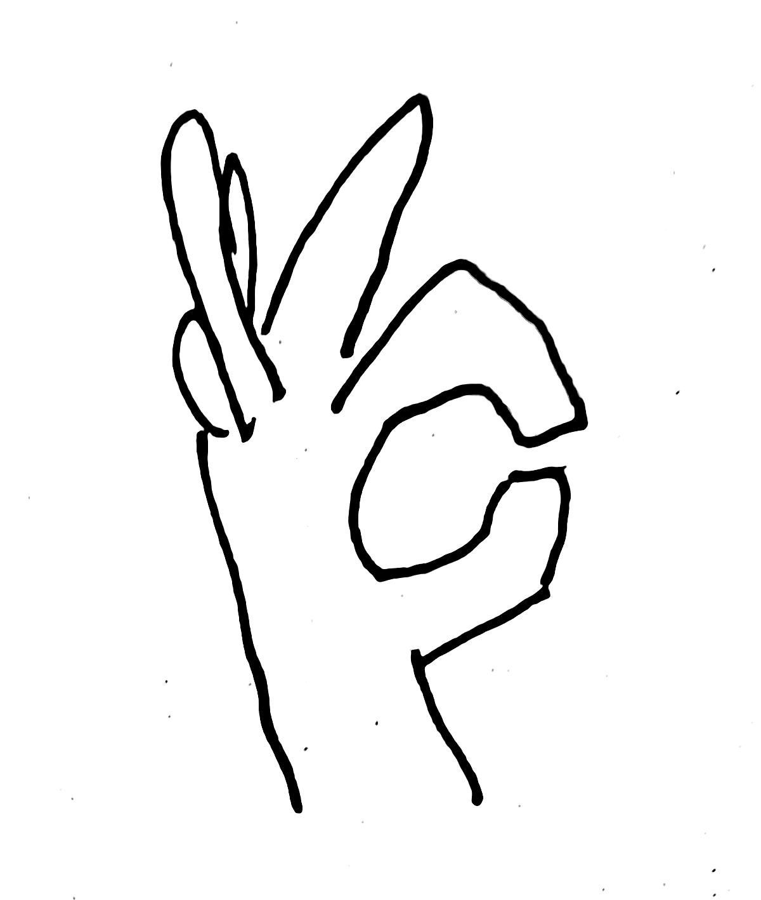
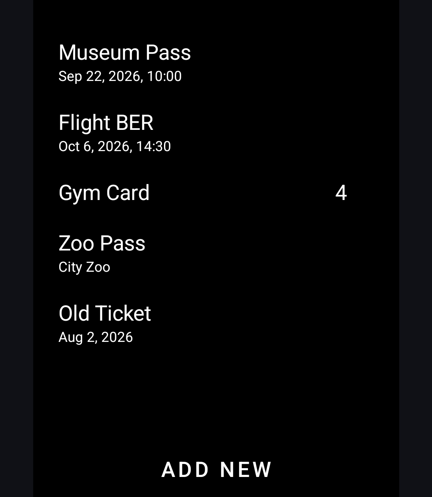
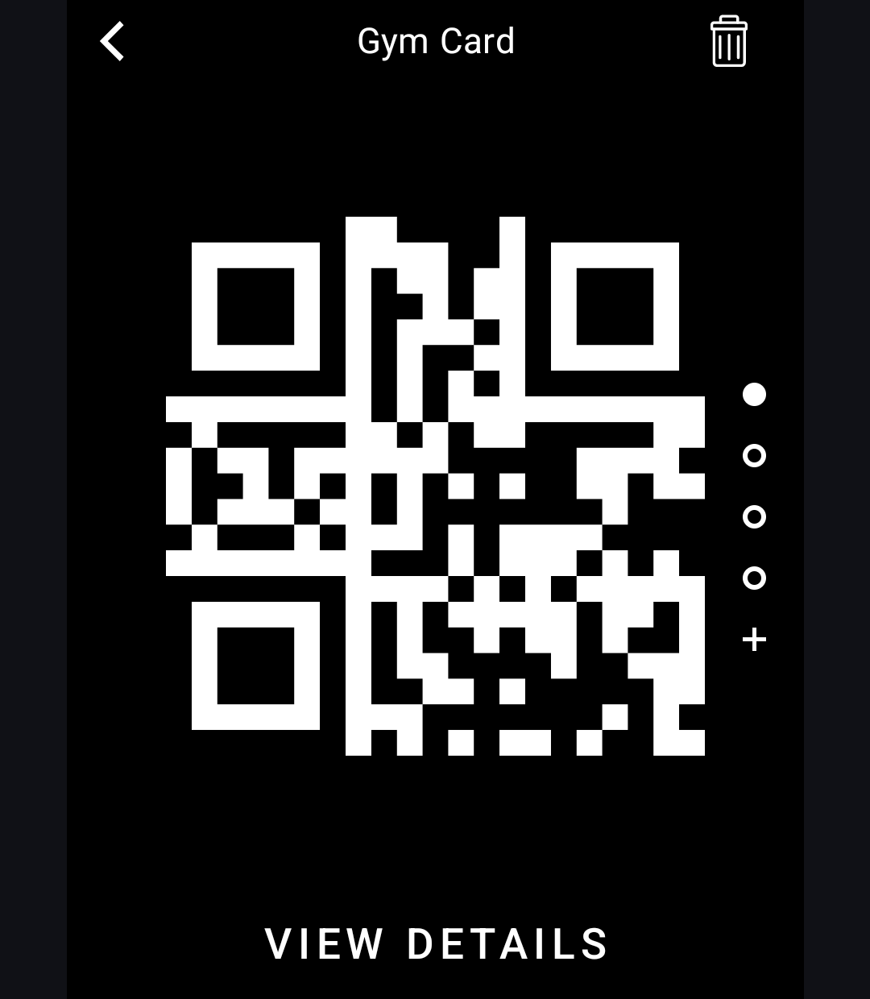
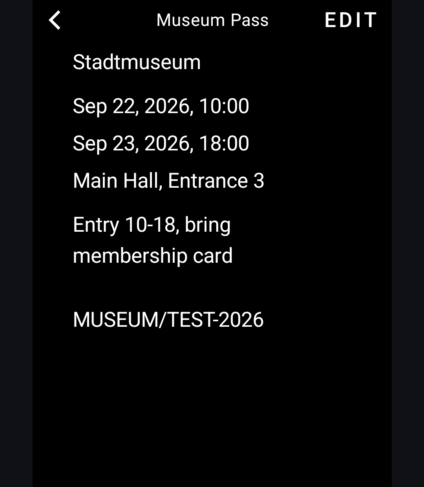
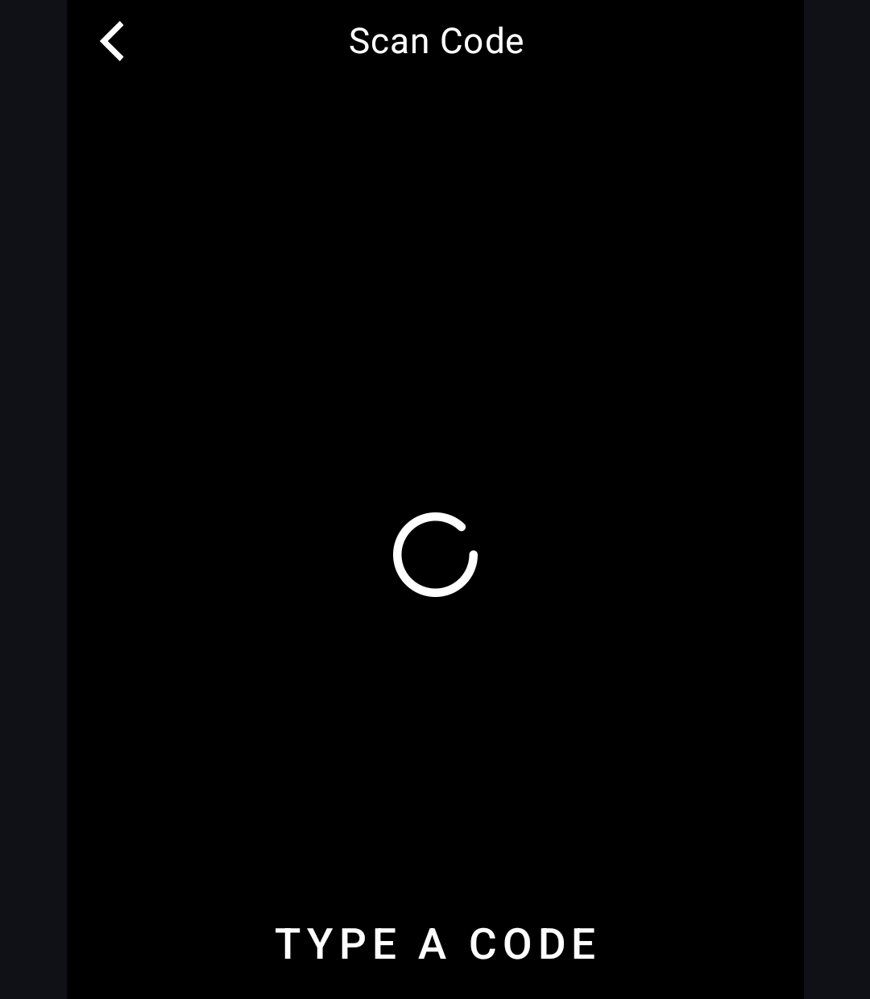

# Passes

<p align="center"><a href="https://ko-fi.com/fenleon">
  <picture><source media="(prefers-color-scheme: dark)" srcset="art/coffee-hand-filled-alpha-white-steam.png"></picture>
  <picture><source media="(prefers-color-scheme: dark)" srcset="art/buy-me-a-coffee-alpha-white.png"></picture>
  </a></p>

An app for the Light Phone III to store and show codes: boarding passes,
library cards, memberships, anything a barcode or QR code represents.

Built as a **LightOS tool** with the [light-phone/light-sdk](https://github.com/lightphone/light-sdk)
tool plugin.

## Features

- Store a code by **scanning** it with the camera or by **typing** it on the LP3 keyboard
  (typed codes are stored as QR).

- The scanner captures the **exact symbol grid**, so a code is rendered back as the identical symbol.
  
- **Stack codes** under one name.

- The renderer supports 13 barcode formats (QR Code, Aztec, EAN-13, EAN-8,
  PDF417, UPC-E, Data Matrix, Code 39, Code 93, ITF-14, Codabar, Code 128,
  UPC-A).

## Screenshots

| | |
|---|---|
|  |  |
|  |  |

## Build

Single-module Gradle project consuming the SDK as an included build:

```bash
source tools/env.sh
tools/build --dir passes :tool:assembleDebug
```

APK (signed with the SDK dev keystore):

- Tool: `tool/build/outputs/apk/debug/tool-debug.apk` — `com.lightphone.passes`

Release builds (R8, ~14 MB):

```bash
tools/build --dir passes -Dorg.gradle.jvmargs="-Xmx5g -XX:MaxMetaspaceSize=768m" \
  -Dkotlin.daemon.jvmargs="-Xmx2g" :tool:assembleRelease
```

## Install & run (emulator)

```bash
adb install -r tool/build/outputs/apk/debug/tool-debug.apk
# the tool's camera permission is granted at install; on the emulator:
adb shell pm grant com.lightphone.passes android.permission.CAMERA
adb shell am start -n com.lightphone.passes/com.thelightphone.sdk.LightActivity
```

The tool also appears in the LightOS toolbox. `lighttool.toml`'s
`serverPackage` is required by the plugin; the merged build has no companion,
so it points at the **platform's own SDK server** — `com.lightos` on a real
LP3 (which hosts the service LightOS uses for runtime permission requests,
verified 2026-08-18). When testing scanning on the emulator, flip it to
`com.thelightphone.sdk.emulator` (or pre-grant CAMERA with `pm grant`).

## License

MIT — see [LICENSE](LICENSE). Original work © Vandam Dinh.

<p align="center">Support my work by leaving me a <a href="https://ko-fi.com/fenleon">tip</a> or <a href="https://github.com/sponsors/fenleon">sponsoring me</a>. A little goes a long way.</p>
